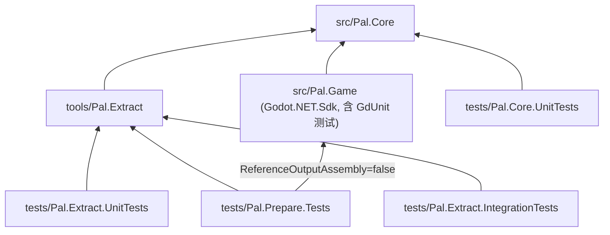

# 研究：常规增量选测方案（依赖图 + 路径映射 + 回退）

- 票：[#243](https://github.com/fanxiao92/godot-pal/issues/243)；地图：[#240 M7 验证基建路线图](https://github.com/fanxiao92/godot-pal/issues/240)（约束见 Notes 第 1、3、7、9 条）。
- 本地事实基线：`origin/main` @ `7f0567b`（2026-11-26）。外部来源检索于 2026-11-26，并钉到具体提交/标签：
  dotnet-affected `main@34fca17`（最新发布 v7.0.1，2026-10-07）、gdUnit4Net `master@31a1934`、Godot `4.7.2-stable`。
- 本文只做研究与推荐；未运行 Godot、`dotnet test`、Prepare 或任何引擎进程。

## 0. 问题与已定约束

地图 Notes 第 3 条已确认：CI 的 T1/T2 跑公开可跑全量；**增量选测只服务本地 T0 / agent 日常反馈**，采用"工程级（dotnet 依赖图）+ 路径→测试批次映射，未知路径安全回退全量；不做用例级 TIA"。第 1 条：T0 目标 < 2 分钟；第 9 条：测试拆到 `tests/` 下独立工程（#244）。因此本研究回答的是"在这些约束下，常规做法的具体落地形态"，而不是"要不要增量"。

由此得出的一个关键定位：**T0 的选测是加速反馈，不是正确性闸门；正确性兜底是 T1 全量**（Notes 第 3 条）。选测规则因此应当"宁多勿漏，但不必为极端情况做到精确"。

## 1. 本仓库现状（本地事实）

### 1.1 工程依赖图

`dotnet sln GodotPal.sln list` 列出 7 个工程；`ProjectReference` 边（取自各 `.csproj`）：



- 来源：[Pal.Game.csproj](../../src/Pal.Game/Pal.Game.csproj)、[Pal.Prepare.Tests.csproj](../../tests/Pal.Prepare.Tests/Pal.Prepare.Tests.csproj) 及其余 `.csproj`。
- `Pal.Game` 当前同时是生产工程和 GdUnit 测试工程（`IsTestProject=true`，[Pal.Game.csproj#L6](../../src/Pal.Game/Pal.Game.csproj#L6)）；#244 拆分后会多出 `tests/` 下的 Game 测试工程，本文的映射表按拆分后形态设计。
- 仓库**没有** `Directory.Build.props/targets`、`Directory.Packages.props`（2026-11-26 递归检索结果为空），也没有条件化的 `ProjectReference`。这意味着直接读 `.csproj` XML 得到的引用边与 MSBuild 求值结果一致——这是第 3 节推荐"自写"的前提，需在映射自检中守住。
- `tests/Pal.Game.Tests/Fixtures/DotnetBoundary/DotnetBoundary.csproj` 不在 sln 内，是 fixture，不应进入依赖图。

### 1.2 跨目录链接的源文件（"按目录归属"会漏的情形）

| 被链接文件 | 链入工程 |
| --- | --- |
| `tests/Fixtures/BattleContextTestFixture.cs` | `Pal.Game`、`Pal.Core.UnitTests`、`Pal.Prepare.Tests` |
| `tests/Fixtures/M1Bundle.cs`、`tests/Fixtures/ProjectedStoryChainTables.cs` | `Pal.Prepare.Tests` |
| `tests/Pal.Extract.Tests/Fixtures/Yj2TestData.cs` | `Pal.Extract.UnitTests`、`Pal.Extract.IntegrationTests` |
| `tests/Pal.Extract.UnitTests/Fixtures/BattleProjectionFixture.cs` | `Pal.Extract.IntegrationTests`（同时也在 `Pal.Extract.UnitTests` 目录内） |

来源：各 `.csproj` 的 `<Compile Include=... Link=...>`。按"文件所在目录 → 工程"的朴素映射会把这些改动只归给目录所属工程（或不归给任何工程），因此映射表必须显式列出它们，并由自检保证不漂移（第 5.3 节）。

### 1.3 Godot 侧非代码文件不是 MSBuild 项

Godot.NET.Sdk 4.7.2 在导入 `Microsoft.NET.Sdk` 后设置 `<EnableDefaultNoneItems>false</EnableDefaultNoneItems>`（[Sdk.props#L42-L44 @ 4.7.2-stable](https://github.com/godotengine/godot/blob/4.7.2-stable/modules/mono/editor/Godot.NET.Sdk/Godot.NET.Sdk/Sdk/Sdk.props#L42-L44)）。因此 `.tscn`、`.tres`、`.gd`、`project.godot`、`*.uid`、导入资源等**不会**作为 `None` 项出现在 `Pal.Game` 的 MSBuild 求值结果里；任何"按 MSBuild 输入项归属文件"的工具都看不到它们（见 3.1 节盲区）。这类文件只能由路径映射表覆盖。

### 1.4 现有的批次划分与 affected 守卫

- [`Get-GameBatchPlan`](../../scripts/GameTestBatches.ps1#L94-L127) 把 1100 个 Game 用例按**类名列表 + `FullyQualifiedName~` 子串**划成 10 个批次（`process`、`scene-dialogue`、`scene-dynamic`、`scene-battle-heavy-a..d`、`scene-battle-light`、`native-map`、`scene-realfull`），并硬编码每批数量与总数（[#L171](../../scripts/GameTestBatches.ps1#L171)）。`StoryRoundtripSceneTests` 一个类按方法名拆进 6 个批次。
- [native-map affected 守卫](../../scripts/GameTestBatches.ps1#L328-L376) 是仓库唯一已有的"路径 → 批次"规则：`src/Pal.Game/Scripts/Profiles`、`Scripts/Resources`、`Editor`、`samples/authored-battle`、`src/Pal.Game/Samples` 变化后必须跑 `native-map`。注释记录了其动机：M4 期间两次改动这些目录却没重跑 `native-map`，只有完整门才抓到（[#L329-L333](../../scripts/GameTestBatches.ps1#L329-L333)）。这条经验应原样进入新映射表。
- [getting-started.md](../testing/getting-started.md#L5-L12) 目前是"人按变更选一两个工程"的手工表；新方案应把这张表机器化。

## 2. 从改动得到文件清单

通行做法是"基线 = 主干，终点 = 当前工作区"：

- dotnet-affected：`--from` 默认 `HEAD`，终点**永远是工作区**；`--uncommitted all|staged|none` 决定已暂存、未暂存和未跟踪文件是否计入，默认 `all`（[cli.md#L167-L189](https://github.com/leonardochaia/dotnet-affected/blob/34fca17bcfa19af57822090a3fce205053baaabc/docs/src/content/docs/reference/cli.md#L167-L189)）。
- Nx：`base` 默认 `main` 分支，`head` 默认"当前文件系统"，并说明这"通常正是本地开发想要的"（[affected.mdoc#L79](https://github.com/nrwl/nx/blob/master/astro-docs/src/content/docs/features/CI%20Features/affected.mdoc)）。
- 删除的文件也必须计入：dotnet-affected 专门在求值前把删除文件从 `from` 提交读回叠加，否则引用它的工程会"看起来从未变化"（[how-it-works.md#L49-L55](https://github.com/leonardochaia/dotnet-affected/blob/34fca17bcfa19af57822090a3fce205053baaabc/docs/src/content/docs/getting-started/how-it-works.md#L49-L55)）。

对本仓库（T0 本地）推荐：

```text
base    = git merge-base origin/main HEAD
changed = git diff --name-status -M <base>             # 已提交 + 工作区已跟踪改动（含删除；重命名取新旧两侧路径）
        ∪ git ls-files --others --exclude-standard     # 未跟踪文件
```

命令语义见 [git-merge-base](https://git-scm.com/docs/git-merge-base)、[git-diff](https://git-scm.com/docs/git-diff)（`<commit>` 单参数形式比较该提交与工作区）、[git-ls-files](https://git-scm.com/docs/git-ls-files)（`--others --exclude-standard`）。前门应提供 `--base <ref>` 覆盖与 `--all` 强制全量。

## 3. 工程级依赖图的获取方式

| 方式 | 机制 | 优点 | 缺点 / 本仓库适配 |
| --- | --- | --- | --- |
| **A. dotnet-affected**（CLI / MSBuild SDK） | git diff → 发现工程 → MSBuild `ProjectGraph` → 用 `Microsoft.Build.Prediction` 把改动文件归到"以它为输入的工程" → 沿图找传递依赖方 → 输出 traversal/text/json/slnf（[how-it-works.md#L8-L40](https://github.com/leonardochaia/dotnet-affected/blob/34fca17bcfa19af57822090a3fce205053baaabc/docs/src/content/docs/getting-started/how-it-works.md#L8-L40)） | 现成、活跃维护（v7.0.1，2026-10-07）；归属覆盖 MSBuild 拉入的任意项及 `Directory.Build.props` 这类导入（[#L33-L35](https://github.com/leonardochaia/dotnet-affected/blob/34fca17bcfa19af57822090a3fce205053baaabc/docs/src/content/docs/getting-started/how-it-works.md#L33-L35)）；相对路径按工程目录解析，故 `Link` 进来的 `../../tests/Fixtures/*.cs` 能正确归属（[FilesByProjectGraphCollector.cs#L100-L111](https://github.com/leonardochaia/dotnet-affected/blob/34fca17bcfa19af57822090a3fce205053baaabc/src/DotnetAffected.Core/Prediction/FilesByProjectGraphCollector.cs#L100-L111)）；理解 `Directory.Packages.props` 包版本变化；可用 `--filter-file-path GodotPal.sln` 限定工程集合（[cli.md#L112-L131](https://github.com/leonardochaia/dotnet-affected/blob/34fca17bcfa19af57822090a3fce205053baaabc/docs/src/content/docs/reference/cli.md#L112-L131)）；推荐用本地工具清单钉版本（[installation.md#L10-L25](https://github.com/leonardochaia/dotnet-affected/blob/34fca17bcfa19af57822090a3fce205053baaabc/docs/src/content/docs/getting-started/installation.md#L10-L25)） | **只归属 MSBuild 输入项**：仓库根之外的路径直接忽略（[#L87-L91](https://github.com/leonardochaia/dotnet-affected/blob/34fca17bcfa19af57822090a3fce205053baaabc/src/DotnetAffected.Core/Prediction/FilesByProjectGraphCollector.cs#L87-L91)），而 Godot SDK 关闭了默认 `None` 项（1.3 节），`.tscn/.tres/.gd/project.godot` 都归不到任何工程；**输出只有工程列表**（四种格式均为工程，[cli.md#L236-L245](https://github.com/leonardochaia/dotnet-affected/blob/34fca17bcfa19af57822090a3fce205053baaabc/docs/src/content/docs/reference/cli.md#L236-L245)），只对"无主的 `.csproj`"给警告（[how-it-works.md#L42-L47](https://github.com/leonardochaia/dotnet-affected/blob/34fca17bcfa19af57822090a3fce205053baaabc/docs/src/content/docs/getting-started/how-it-works.md#L42-L47)），无法据此实现"未匹配路径 → 全量"，仍需自有路径表；退出码 `166` 只表示"什么都没变"，与"有变化但无依赖方"(`0`) 不同，调用方需正确区分（[exit-codes.md](https://github.com/leonardochaia/dotnet-affected/blob/34fca17bcfa19af57822090a3fce205053baaabc/docs/src/content/docs/reference/exit-codes.md)）；每次运行都要求值所有工程（含需从 NuGet 解析的 `Godot.NET.Sdk/4.7.2`）；依赖 LibGit2Sharp，曾在使用相对路径 worktree（git 2.48+ `extensions.relativeworktrees`）的仓库崩溃（[issue #194](https://github.com/leonardochaia/dotnet-affected/issues/194)，2026-10-07 关闭，与 v7.0.1 同日；本仓库当前 worktree 未启用该扩展）。默认 traversal 输出还依赖 `Microsoft.Build.Traversal` SDK（[cli.md#L270-L278](https://github.com/leonardochaia/dotnet-affected/blob/34fca17bcfa19af57822090a3fce205053baaabc/docs/src/content/docs/reference/cli.md#L270-L278)），本仓库应改用 `--format json/text` |
| **B. 自写，调用 MSBuild `ProjectGraph` API** | `Microsoft.Build.Graph.ProjectGraph` 从入口（sln/csproj）递归求值 `ProjectReference`，节点提供 `ProjectReferences`/`ReferencingProjects`（[ProjectGraph 文档](https://learn.microsoft.com/dotnet/api/microsoft.build.graph.projectgraph)、[ProjectGraphNode](https://learn.microsoft.com/dotnet/api/microsoft.build.graph.projectgraphnode)）；边由 `ProjectReference` 项决定（[static-graph.md#L90](https://github.com/dotnet/msbuild/blob/main/documentation/specs/static-graph.md)） | 与 A 同等精确，不引第三方 | 需要一个 C# 小工具 + MSBuildLocator，等于重写 A 的一半；对 7 个工程收益不成比例 |
| **C. 自写，调用 dotnet CLI 只读求值** | `dotnet msbuild <proj> -getItem:ProjectReference -getItem:Compile` 在不构建的前提下输出求值后的项（[MSBuild 命令行参考](https://learn.microsoft.com/visualstudio/msbuild/msbuild-command-line-reference)）；或 `dotnet reference list`（.NET 10 名词前置形式，[文档](https://learn.microsoft.com/dotnet/core/tools/dotnet-reference-list)） | 零依赖、得到真实求值结果（含 `Link` 的 `Compile` 项） | 每个工程一次求值，T0 每次都跑会吃掉秒级预算；适合放在**自检**里而不是每次选测路径上 |
| **D. 自写，静态读 `.csproj` XML + 守卫** | 直接解析 `<ProjectReference Include>`（现有 [GameTestBatches.ps1#L194-L199](../../scripts/GameTestBatches.ps1#L194-L199) 已用同类解析读 sln/csproj） | 最快、零依赖、pwsh 7 跨平台；对本仓库当前形态精确（1.1 节：无 `Directory.Build.*`/CPM/条件引用） | 一旦引入 `Directory.Build.props`、CPM 或条件引用就不再精确——用"任何构建结构文件变化 → 全量"（第 5 节）保证增量路径上图不会过期，并在自检里用方式 C 校验 |

结论：A 是 .NET 生态的标准答案，但它解决的主要难点（导入文件、CPM 包变化、删除文件叠加、大图性能）在本仓库要么不存在，要么已被"构建结构文件 → 全量"规则吸收；它**解决不了**本仓库真正的难点（Godot 非代码文件归属与"未匹配 → 全量"），路径表无论如何都要写。故推荐 D（选测路径）+ C（自检），A 作为条件变化后的升级路线（第 7 节）。

## 4. Godot 侧：路径 → GdUnit 测试分组

### 4.1 gdUnit4Net 对过滤的支持

- gdUnit4 测试适配器基于 VSTest 过滤，支持属性 `FullyQualifiedName`、`Name`、`Class`、`Namespace`、`TestCategory`、`Trait.{name}`，运算符 `= != ~ !~`，逻辑 `& | !` 与括号（[TestFilterGuide.md#L9-L55](https://github.com/MikeSchulze/gdUnit4Net/blob/31a19348c842770fc5a2445b596b99cb8ca2d21d/TestAdapter/TestFilterGuide.md#L9-L55)）；实现直接调用 `IRunContext.GetTestCaseFilter`（[TestCaseFilter.cs#L20-L32](https://github.com/MikeSchulze/gdUnit4Net/blob/31a19348c842770fc5a2445b596b99cb8ca2d21d/TestAdapter/src/execution/TestCaseFilter.cs#L20-L32)）。
- `[TestCategory("...")]` 与 `[Trait("k","v")]` 可加在方法或类上、可多次使用（[TestCategoryAttribute.cs#L13](https://github.com/MikeSchulze/gdUnit4Net/blob/31a19348c842770fc5a2445b596b99cb8ca2d21d/Api/src/core/attributes/TestCategoryAttribute.cs#L13)、[TraitAttribute.cs#L34](https://github.com/MikeSchulze/gdUnit4Net/blob/31a19348c842770fc5a2445b596b99cb8ca2d21d/Api/src/core/attributes/TraitAttribute.cs#L34)）；类级类别被方法继承并与方法级合并，`Trait("Category", x)` 与 `TestCategory(x)` 视为同一类别（[TestFilterGuide.md#L225-L260](https://github.com/MikeSchulze/gdUnit4Net/blob/31a19348c842770fc5a2445b596b99cb8ca2d21d/TestAdapter/TestFilterGuide.md#L225-L260)）。`TestCategoryAttribute` 早在 2025-04 已存在于 Api（文件历史最早提交 `dc10a3c5`，2025-04-28），因此当前 fork 与 #244 拟用的官方 `gdUnit4.api 5.1.0-rc7` 都应具备，实际可用性由 #244 原型确认。
- 通用 `dotnet test --filter` 语法与转义见 [selective-unit-tests.md](https://learn.microsoft.com/dotnet/core/testing/selective-unit-tests)；xUnit 侧的可过滤属性是 `FullyQualifiedName`、`DisplayName`、`Traits`（同页表格）。

### 4.2 分组载体比较

| 载体 | 现状/形态 | 评价 |
| --- | --- | --- |
| `FullyQualifiedName~` 子串列表（现状） | 批次由类名/方法名子串拼出 filter（[GameTestBatches.ps1#L149-L150](../../scripts/GameTestBatches.ps1#L149-L150)） | 成员关系写在脚本里，离测试代码远；需要源码正则清点与数量冻结来防漂移（[#L28-L75](../../scripts/GameTestBatches.ps1#L28-L75)、[#L171](../../scripts/GameTestBatches.ps1#L171)），正是地图 Notes 第 1 条要退役的重型规则 |
| 命名空间 / 目录 | 拆分后按 `tests/Pal.Game.Tests/<Area>/` + `Namespace=` 过滤 | 简单，但现有测试全在单一命名空间 `Pal.Game.Tests`（[#L35](../../scripts/GameTestBatches.ps1#L35)），且第 14 条要求原样迁移，重排目录不宜在 M7 做 |
| **`[TestCategory("<batch>")]`（推荐）** | 类级为主，少数需拆分的类用方法级 | 成员关系与测试同处一处，用标准 VSTest filter `TestCategory=<batch>` 选择；不需要源码正则清点。约束"每个 Game 用例恰好一个批次类别"可在发现阶段（`dotnet test --list-tests` 或 TRX）校验，取代数量冻结 |

### 4.3 映射表形态

推荐一张仓库内数据文件（例如 `tests/affected-map.psd1`，pwsh 7 用 [`Import-PowerShellDataFile`](https://learn.microsoft.com/powershell/module/microsoft.powershell.utility/import-powershelldatafile) 安全读取，无需依赖；也可用 JSON），由前门 `pal.ps1` 唯一读取。语义：

1. **目标（target）** 是可单独运行的测试单元：`core-unit`、`extract-unit`、`extract-integration`、`prepare`、`game:<category>`，以及 `game:*`（Game 全部类别）。每个目标对应一条 `dotnet test <project> [--filter TestCategory=...]`。
2. **规则** 有序排列，每条为 `paths`（glob）+ `action`：`full`（全量）、`none`（不需要测试）、或 `targets = [...]`。
3. 每个改动文件与**所有**规则匹配：任一命中 `full` → 全量；否则取所有命中规则 `targets` 的并集；**一条都不命中 → 全量**（默认）。
4. 工程级扩展：命中某工程目录（或其链接文件）得到"直接改动工程"，再沿 `ProjectReference` 反向传递闭包，把依赖方工程的测试目标加入（与 dotnet-affected 的"changed vs affected"语义一致，[how-it-works.md#L57-L81](https://github.com/leonardochaia/dotnet-affected/blob/34fca17bcfa19af57822090a3fce205053baaabc/docs/src/content/docs/getting-started/how-it-works.md#L57-L81)）。
5. 前门打印**每个文件的命中规则与理由**，以及最终目标集合；`--explain` 只打印不运行。

示意（路径按 #244 拆分后的假设布局；Game 子目录到类别的具体对应需由 #244/#246 结合实测耗时确定，下面仅示范结构，类别名沿用现有批次名）：

```powershell
@{
  Version = 1
  Rules = @(
    # 1) 强制全量：构建结构 / 测试基建 / 选测器自身（第 5 节完整清单）
    @{ Paths = @('*.sln', '*.slnx', '**/*.csproj', '**/Directory.Build.*', 'Directory.Packages.props',
                 'global.json', 'NuGet.Config', '.config/dotnet-tools.json', '**/*.runsettings',
                 'src/Pal.Game/project.godot', 'src/Pal.Game/export_presets.cfg', '.gitattributes',
                 'scripts/**', 'pal.ps1', 'tests/affected-map.psd1', '.github/**'); Action = 'full' }

    # 2) 无需测试
    @{ Paths = @('docs/**', '*.md', 'reference/**'); Action = 'none' }

    # 3) 工程目录 → 工程（工程级，之后沿 ProjectReference 扩展依赖方）
    @{ Paths = @('src/Pal.Core/**');                 Project = 'src/Pal.Core/Pal.Core.csproj' }
    @{ Paths = @('tools/Pal.Extract/**');            Project = 'tools/Pal.Extract/Pal.Extract.csproj' }
    @{ Paths = @('tests/Pal.Core.UnitTests/**');     Targets = @('core-unit') }
    @{ Paths = @('tests/Pal.Extract.UnitTests/**');  Targets = @('extract-unit') }
    @{ Paths = @('tests/Pal.Extract.IntegrationTests/**'); Targets = @('extract-integration') }
    @{ Paths = @('tests/Pal.Prepare.Tests/**');      Targets = @('prepare') }

    # 4) 跨目录链接文件（必须与 .csproj 的 <Compile Link> 一致，自检保证）
    @{ Paths = @('tests/Fixtures/BattleContextTestFixture.cs'); Targets = @('core-unit', 'prepare', 'game:*') }
    @{ Paths = @('tests/Fixtures/M1Bundle.cs', 'tests/Fixtures/ProjectedStoryChainTables.cs'); Targets = @('prepare') }
    @{ Paths = @('tests/Pal.Extract.Tests/Fixtures/Yj2TestData.cs'); Targets = @('extract-unit', 'extract-integration') }

    # 5) Godot 路径 → GdUnit 类别（保留 M4 native-map 守卫经验）
    @{ Paths = @('src/Pal.Game/Scripts/Profiles/**', 'src/Pal.Game/Scripts/Resources/**', 'src/Pal.Game/Editor/**',
                 'src/Pal.Game/Samples/**', 'samples/authored-battle/**'); Targets = @('game:native-map', 'prepare') }
    @{ Paths = @('src/Pal.Game/**');                  Targets = @('game:*', 'prepare') }   # 其余 Game 生产代码/场景：保守跑 Game 全部
    @{ Paths = @('tests/Pal.Game.Tests/**');          Targets = @('game:*') }               # 单个测试文件 → 可进一步收窄到其类别
  )
}
```

说明：

- `src/Pal.Game/**` 兜底到 `game:*` 是保守默认；只有在给出"子目录 → 类别"的细则并经实测后，才逐条收窄（Nx 文档同样强调"选择来自声明的输入"，声明不全就会漏选，[affected.mdoc#L68-L72](https://github.com/nrwl/nx/blob/master/astro-docs/src/content/docs/features/CI%20Features/affected.mdoc)）。
- `prepare` 出现在 Game 规则里，是因为 `Pal.Prepare.Tests` 对 `Pal.Game` 有 `ProjectReference`（1.1 节）；工程级扩展会自动加上，示意中显式写出只为可读。
- 改动的 Game 测试文件可以只跑它所属的类别（读取文件中的 `[TestCategory]`），这是"测试文件本身变化"的常见收窄，不属于用例级 TIA。

## 5. 安全回退规则

### 5.1 必须触发全量的路径

| 类别 | 路径 | 理由 |
| --- | --- | --- |
| 解决方案与工程结构 | `*.sln`/`*.slnx`、`**/*.csproj`、`**/Directory.Build.props/targets`、`Directory.Packages.props` | 改变依赖图本身；也是方式 D 静态解析保持精确的前提（3 节）。dotnet-affected 也需对导入文件和 CPM 做专门处理才能正确（[how-it-works.md#L33-L37](https://github.com/leonardochaia/dotnet-affected/blob/34fca17bcfa19af57822090a3fce205053baaabc/docs/src/content/docs/getting-started/how-it-works.md#L33-L37)） |
| SDK / 包源 / 工具 | `global.json`、`NuGet.Config`、`.config/dotnet-tools.json` | 改变所有工程的构建与还原；Nx 默认把包管理器锁文件变化视为影响每个任务（[affected.mdoc#L201](https://github.com/nrwl/nx/blob/master/astro-docs/src/content/docs/features/CI%20Features/affected.mdoc)） |
| 测试运行配置 | `**/*.runsettings`（`tests/unit.runsettings`、`tests/Pal.Game.Tests/game.runsettings`） | 改变发现/失败判定，影响所有使用它的工程 |
| Godot 工程级配置 | `src/Pal.Game/project.godot`、`export_presets.cfg`（若存在）、`src/Pal.Game/addons/**`（若引入） | 影响引擎启动、自动加载、输入映射等全局行为；且不是 MSBuild 项（1.3 节） |
| 选测与前门自身 | `pal.ps1`、映射表、`scripts/**` | 选择逻辑或执行方式变化时，"用旧规则选新规则"不可信 |
| CI / 仓库属性 | `.github/**`、`.gitattributes` | CI 由 T1 全量覆盖；`.gitattributes` 曾因 LFS 指针导致 163 个测试失败（[ci.yml 注释](../../.github/workflows/ci.yml)） |
| 共享测试夹具（未逐条列出者） | `tests/Fixtures/**` 中未被规则 4 显式认领的文件 | 消费方不明；靠"未匹配 → 全量"自然覆盖 |

### 5.2 未匹配路径的默认行为

**默认全量**，并在输出中列出未匹配文件、提示补表。这与 Azure Pipelines TIA 的"安全回退"一致：遇到它无法推理的提交或未知文件类型（如 HTML/CSS），就运行全部测试（[Use Test Impact Analysis](https://learn.microsoft.com/azure/devops/pipelines/test/test-impact-analysis)，"Safe fallback"段）。

其他边界：

- **没有任何改动**：不运行任何测试并明确说明"无改动"（对应 dotnet-affected 的 `166` 语义，[exit-codes.md#L14-L30](https://github.com/leonardochaia/dotnet-affected/blob/34fca17bcfa19af57822090a3fce205053baaabc/docs/src/content/docs/reference/exit-codes.md#L14-L30)），需要时用 `--all`。
- **只命中 `none`**（纯文档）：不运行测试，但报告中写明"仅文档改动，未运行测试"。
- **删除与重命名**：新旧两侧路径都参与匹配（2 节）。

### 5.3 映射表自检（替代数量冻结）

自检放在 T1（以及映射表改动时的本地运行），失败即报错，不进 T0 热路径：

1. 用 `dotnet msbuild -getItem:Compile -getItem:ProjectReference`（方式 C）求值每个 sln 工程，断言：静态解析的引用边与求值结果一致；所有位于工程目录之外的 `Compile` 项都被映射表规则 4 认领且目标正确。
2. 断言 sln 中每个测试工程至少被一条规则映射到目标。
3. Game 测试发现后断言：每个用例恰好带一个批次类别；映射表引用的类别都存在。
4. （可选）列出当前被"未匹配 → 全量"兜住的已跟踪文件，作为补表提示而非失败。

## 6. 用例级 TIA：业界评价与本场景不采用的理由

### 6.1 业界做法与评价

- **用例级 TIA 的机制**：对每个测试收集覆盖，建立"生产源文件 → 会执行它的测试"映射，并随时间重算；Microsoft 早期用块级覆盖 + IL diff 实现，存储开销大（Paul Hammant，[The Rise of Test Impact Analysis](https://martinfowler.com/articles/rise-test-impact-analysis.html)）。同文指出 Google Blaze/Bazel、Facebook Buck 等"有向图构建系统"通过显式依赖声明选择测试，效果与 TIA 相近，前提是长期维护 BUILD 依赖。
- **Azure Pipelines TIA**（Microsoft 唯一的产品化 .NET 用例级 TIA）：仅限托管代码、单机拓扑、仅 Visual Studio Test 任务 v2.*；遇到无法推理的文件类型回退全量；建议按周期配置全量运行；非代码依赖需手写 XML 依赖映射（[Use Test Impact Analysis](https://learn.microsoft.com/azure/devops/pipelines/test/test-impact-analysis)）。
- **Google TAP**：即使投入巨大资源，也无法对每个改动单独回归；其研究发现极少测试会失败，而失败的测试通常离被测代码"更近"（[Taming Google-Scale Continuous Testing](https://research.google/pubs/taming-google-scale-continuous-testing/)，ICSE-SEIP 2017）——支持"按依赖距离选择"的工程级做法。
- **Meta 预测式选测**：在其单体仓库规模下，连"所有可能受影响的测试"都跑不起，于是用历史结果训练模型选测，在成本减半的同时报告 >95% 的单测失败与 >99.9% 的问题改动（[Predictive Test Selection](https://arxiv.org/abs/1810.05286)）。这类方法依赖大规模历史数据集，适用前提与本仓库相差几个数量级。
- **Nx**：`affected` 以工程/任务的声明输入为粒度（Nx 23 及以前是"工程级 affected"），默认 base 为 `main`（[affected.mdoc#L79、#L210](https://github.com/nrwl/nx/blob/master/astro-docs/src/content/docs/features/CI%20Features/affected.mdoc)）——主流 monorepo 工具的默认粒度也是工程/任务，而非用例。

### 6.2 本场景不采用的理由

1. **Godot 内容文件不是代码**：场景、资源、GDScript、`project.godot` 不在 MSBuild 项中（1.3 节），覆盖映射看不到它们；按 Azure TIA 的规则这类改动只能回退全量，而这类改动正是本仓库 Game 层的常见改动。
2. **执行环境不匹配**：Game 测试在 Godot 引擎进程内由 gdUnit4 适配器执行；gdUnit4Net 的过滤指南只提供名称/类别/Trait 过滤（4.1 节），未发现逐用例覆盖映射能力；Azure TIA 又绑定 Azure Pipelines 的 VSTest 任务，与"Linux GitHub runner + 本地 pwsh 前门"（Notes 第 2、7 条）都不兼容。自研需要逐用例覆盖收集、映射存储与失效管理，成本高于其收益。
3. **规模不需要**：约 3800 个用例、7 个工程；CI 已定为全量（Notes 第 3 条），增量只为本地反馈提速。按 Google/Meta 的经验，用例级/预测式选择的价值出现在"连全量都跑不起"的规模。
4. **工程级 + 路径表已能给出可解释、可审查的结果**：每个文件的命中规则可打印，用户可读、可改；用例级映射是数据而非规则，难以审查——与本次"退役自制审计工具、降低规则负担"的方向（Notes 第 1、8 条）相悖。

## 7. 推荐方案

1. **工具选择**：不引入新工具。增量选择器作为 `pal.ps1`（pwsh 7）的一部分自写：
   - 改动清单按第 2 节（merge-base + 工作区 + 未跟踪）；
   - 依赖图用方式 D 静态读 sln/`.csproj` XML，反向传递闭包得到依赖方；
   - 构建结构文件变化一律全量，保证静态图在增量路径上不过期；方式 C 只用于第 5.3 节自检。
   - **升级路线**：当仓库引入 `Directory.Build.props`、CPM、条件化 `ProjectReference`，或工程数增长到静态解析难以维护时，把"工程归属 + 依赖方"部分替换为 dotnet-affected（本地工具清单钉版本、`--filter-file-path GodotPal.sln --format json`、注意 `166` 与 `0` 的区别），路径表与回退规则保持不变。
2. **映射表结构**：单一数据文件（建议 `tests/affected-map.psd1`），有序规则 = `paths` + `action(full|none)` / `project` / `targets`；所有命中规则取并集、任一 `full` 即全量；Game 批次成员关系用 `[TestCategory("<batch>")]` 放在测试类上，选测用 `TestCategory=<batch>` 过滤；保留 M4 native-map 守卫路径作为首批 Godot 规则。
3. **强制全量路径清单**：见 5.1 节表格（sln/csproj/Directory.Build.*/Directory.Packages.props、global.json/NuGet.Config/工具清单、`*.runsettings`、`project.godot`/导出配置/addons、`pal.ps1`/映射表/`scripts/**`、`.github/**`、`.gitattributes`、未认领的共享夹具）。
4. **未匹配路径默认**：全量，并打印未匹配文件与补表提示。
5. **证据与交互**：前门输出每个文件的命中规则、最终目标与实际命令；支持 `--all`、`--base <ref>`、`--explain`；T0 报告明确写"增量选择（规则版本 X），非完整验收"，完整性由 T1 全量负责。
6. **用例级 TIA**：不采用（第 6.2 节）。

## 8. 需要用户决定的开放问题

1. **自写 vs dotnet-affected**：本文推荐自写（零依赖、本仓库图小、路径表必须自写）。若更看重"用现成工具、少维护代码"，可直接选 dotnet-affected 负责工程部分——请确认。
2. **Core 改动是否在 T0 连带 Game 全部类别**：按依赖图语义，`Pal.Core` 改动影响 `Pal.Game` 及其全部 Game 用例（加上 `Pal.Extract`/`Prepare` 链），很可能超出 T0 < 2 分钟目标。选项：(a) 严格按图，接受超时；(b) T0 对"仅经 Core 传递影响到 Game"的情况只跑 Core/CLI 单元 + 一个 Game 冒烟类别，Game 全量交给 T1；(c) 按 Core 子域细分映射。需要用户定。
3. **Game 批次载体**：给约 48 个测试类加 `[TestCategory]` 属性，是否与 Notes 第 14 条"原样迁移"冲突？若视为冲突，替代方案是把"类名 → 类别"写在映射表里（回到脚本持有成员关系，但不再需要源码正则清点）。
4. **批次划分是否沿用现有 10 批**：现有拆分（尤其 `StoryRoundtripSceneTests` 拆 6 批、`scene-battle-heavy-a..d`）多为旧门的会话超时预算产物；新类别应按"功能区域"还是沿用旧批次名？建议由 #244/#246 结合实测耗时决定。
5. **纯文档改动**：是否确认"不运行任何测试"（含 `AGENTS.md`、`docs/agents/**` 等 agent 规则文档）？
6. **基线选择**：T0 默认 `merge-base origin/main HEAD` + 工作区（含未跟踪）是否合适？是否需要"相对上次 T0 通过点"的选项？
7. **仓库内非 .NET 部分**（如 `tools/long-running-agent/**`、`tests/*.ps1`/`*.mjs`）：属于本选测器的目标（各自加 target），还是保持"未匹配 → 全量"/另行处理？
8. **T0 超出 2 分钟时**：仅提示，还是允许前门建议用户改跑 `--explain` 后手动收窄？（不建议自动缩范围。）

## 来源

- 本地：[GodotPal.sln](../../GodotPal.sln)、各 `.csproj`、[scripts/GameTestBatches.ps1](../../scripts/GameTestBatches.ps1)、[docs/testing/getting-started.md](../testing/getting-started.md)、[.github/workflows/ci.yml](../../.github/workflows/ci.yml)、[.gitignore](../../.gitignore)。
- dotnet-affected `@34fca17`：[how-it-works.md](https://github.com/leonardochaia/dotnet-affected/blob/34fca17bcfa19af57822090a3fce205053baaabc/docs/src/content/docs/getting-started/how-it-works.md)、[cli.md](https://github.com/leonardochaia/dotnet-affected/blob/34fca17bcfa19af57822090a3fce205053baaabc/docs/src/content/docs/reference/cli.md)、[exit-codes.md](https://github.com/leonardochaia/dotnet-affected/blob/34fca17bcfa19af57822090a3fce205053baaabc/docs/src/content/docs/reference/exit-codes.md)、[installation.md](https://github.com/leonardochaia/dotnet-affected/blob/34fca17bcfa19af57822090a3fce205053baaabc/docs/src/content/docs/getting-started/installation.md)、[PredictionChangedProjectsProvider.cs](https://github.com/leonardochaia/dotnet-affected/blob/34fca17bcfa19af57822090a3fce205053baaabc/src/DotnetAffected.Core/Prediction/PredictionChangedProjectsProvider.cs)、[FilesByProjectGraphCollector.cs](https://github.com/leonardochaia/dotnet-affected/blob/34fca17bcfa19af57822090a3fce205053baaabc/src/DotnetAffected.Core/Prediction/FilesByProjectGraphCollector.cs)、[issue #194](https://github.com/leonardochaia/dotnet-affected/issues/194)、[releases](https://github.com/leonardochaia/dotnet-affected/releases)。
- gdUnit4Net `@31a1934`：[TestFilterGuide.md](https://github.com/MikeSchulze/gdUnit4Net/blob/31a19348c842770fc5a2445b596b99cb8ca2d21d/TestAdapter/TestFilterGuide.md)、[TestCaseFilter.cs](https://github.com/MikeSchulze/gdUnit4Net/blob/31a19348c842770fc5a2445b596b99cb8ca2d21d/TestAdapter/src/execution/TestCaseFilter.cs)、[TestCategoryAttribute.cs](https://github.com/MikeSchulze/gdUnit4Net/blob/31a19348c842770fc5a2445b596b99cb8ca2d21d/Api/src/core/attributes/TestCategoryAttribute.cs)、[TraitAttribute.cs](https://github.com/MikeSchulze/gdUnit4Net/blob/31a19348c842770fc5a2445b596b99cb8ca2d21d/Api/src/core/attributes/TraitAttribute.cs)。
- Godot `4.7.2-stable`：[Godot.NET.Sdk Sdk.props](https://github.com/godotengine/godot/blob/4.7.2-stable/modules/mono/editor/Godot.NET.Sdk/Godot.NET.Sdk/Sdk/Sdk.props)。
- Microsoft：[ProjectGraph](https://learn.microsoft.com/dotnet/api/microsoft.build.graph.projectgraph)、[ProjectGraphNode](https://learn.microsoft.com/dotnet/api/microsoft.build.graph.projectgraphnode)、[MSBuild static graph spec](https://github.com/dotnet/msbuild/blob/main/documentation/specs/static-graph.md)、[MSBuild 命令行参考（-getItem）](https://learn.microsoft.com/visualstudio/msbuild/msbuild-command-line-reference)、[dotnet reference list](https://learn.microsoft.com/dotnet/core/tools/dotnet-reference-list)、[Run selected unit tests（dotnet test --filter）](https://learn.microsoft.com/dotnet/core/testing/selective-unit-tests)、[Use Test Impact Analysis（Azure Pipelines）](https://learn.microsoft.com/azure/devops/pipelines/test/test-impact-analysis)、[Import-PowerShellDataFile](https://learn.microsoft.com/powershell/module/microsoft.powershell.utility/import-powershelldatafile)。
- Git：[git-merge-base](https://git-scm.com/docs/git-merge-base)、[git-diff](https://git-scm.com/docs/git-diff)、[git-ls-files](https://git-scm.com/docs/git-ls-files)。
- 工程实践：Paul Hammant，[The Rise of Test Impact Analysis](https://martinfowler.com/articles/rise-test-impact-analysis.html)（martinfowler.com）；Memon et al.，[Taming Google-Scale Continuous Testing](https://research.google/pubs/taming-google-scale-continuous-testing/)（Google, ICSE-SEIP 2017）；Machalica et al.，[Predictive Test Selection](https://arxiv.org/abs/1810.05286)（Facebook, ICSE-SEIP 2019）；Nx，[affected 文档源](https://github.com/nrwl/nx/blob/master/astro-docs/src/content/docs/features/CI%20Features/affected.mdoc)。
